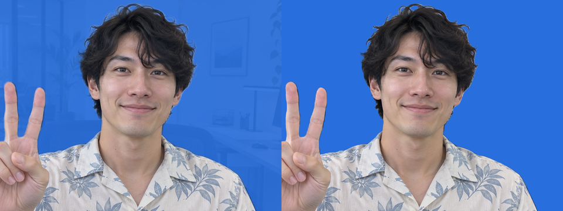

# 比較の基準にする MediaPipe モデル

2026-11-25 13:28 の定期実行で一次情報を確かめた。

## ライセンス

| モデル | ライセンス | 一次情報 |
| --- | --- | --- |
| `selfie_multiclass_256x256` | Apache License 2.0 | Google のモデルカード「Mediapipe Multiclass Segmentation」（2023-05-10、Adel Ahmadyan） |
| `selfie_segmenter_landscape` / `selfie_segmenter` | Apache License 2.0 | Google のモデルカード「MediaPipe Selfie Segmentation」（2021-05-06、Tingbo Hou ほか） |
| `hand_landmarker.task`（指の芯を作る。比較の対象ではない） | Apache License 2.0 | Google のモデルカード「Hand Tracking (Lite/Full) with Fairness」（2021年10月）の2ページ目 |

- MediaPipe 公式ガイド（ai.google.dev の Image Segmenter、2026-11-20 更新）の「Model card」リンクは、Hugging Face の `litert-community/MediaPipe-ImageSegmenter-*` に移っている。各リポジトリに上流の Google のモデルカード PDF が置かれ、README の SHA-256 と取得した PDF の SHA-256 が一致した
- HandLandmarker も同じく `litert-community/MediaPipe-HandLandmarker-Full` に上流の PDF がある。README の `hand_landmarker.task` の SHA-256 は、`scripts/fetch_models.sh` で取ったファイルと一致した（2026-11-26 確認）
- PDF の写しは `research/modelcards/`（multiclass.pdf、selfie.pdf、hand.pdf）。Apache 2.0 なので、比較の基準として測る・推論結果を公開するのに支障はない（推論。条文の個別確認はしていない）

## モデルカードから分かること

| | selfie_segmenter（square / landscape） | selfie_multiclass_256x256 |
| --- | --- | --- |
| 構造 | MobileNetV3 系 CNN ＋ 独自デコーダ | Vision Transformer ＋ 独自ボトルネック・デコーダ |
| サイズ | 249KB / 244KB（float16） | 16.4MB（float32） |
| 入力 | 256×256×3 / 144×256×3、RGB [0,1] | 256×256×3（512×512 版もある） |
| 出力 | person の確率 1ch | 6クラス（background, hair, body-skin, face-skin, clothes, others） |
| 公表 IoU | person IoU 平均 96.48% / 95.99%（社内の自撮り写真 1,594枚、学習と同じ出所） | mIoU 77.23%（256 版）、81.10%（512 版）。918枚・1,902人。クラス平均と思われる |
| 人間の注釈者どうしの一致 | person IoU 98.74% | 記載なし |
| 公表された弱点 | 指などの細い部分が欠けることがある | 逆光・ノイズ・速い動き・大きな遮蔽で劣化 |
| Pixel 6 での推論（公式ガイド） | landscape: CPU 34.19ms / GPU 33.55ms | CPU 217.76ms / GPU 71.24ms |

## 比較の設計に効く点

- 公表値はどれも社内データで、公開テストセットの値ではない。同じ公開テストセットで測り直す価値がある（PLAN の「比較表を作ること自体に価値がある」を裏づける）
- multiclass は person クラスを直接出さない。person マスクは「background 以外の5クラスの和」（1 − background）として作る。この変換をハーネスで固定する
- selfie_segmenter の学習データは「同意を得た AR アプリの写真」で非公開。どの公開テストセットとも重なりは確かめられない
- selfie_segmenter のカードが「指が欠ける」と自ら書いている。手の IoU を下層指標に入れる判断を裏づける

## 精度の初回計測（2026-11-25 13:28 の実行）

精度はブラウザに依らないので、Python の `mediapipe` 1.2.3（CPU、`.venv/`）で測った。レイテンシは別にブラウザで測る。しきい値 0.5。モデルは `storage.googleapis.com/mediapipe-models` の latest（SHA-256 は `models/` のファイルで再計算できる）。

### person IoU: EasyPortrait テスト分割から24枚（seed 0）

`bench/eval_person_iou.py`、結果 `bench/results/2026-11-25-baseline/baseline_iou_ep24.json`

| モデル | 画像ごとの IoU の平均 | 全画素で集計した IoU | 最悪の画像 |
| --- | --- | --- | --- |
| selfie_multiclass_256x256 | 98.29% | 98.31% | 92.72% |
| selfie_segmenter（square） | 97.75% | 97.68% | 89.90% |
| selfie_segmenter_landscape | 97.26% | 97.01% | 84.40% |

- Boundary F（DAVIS の境界 F 値に近い定義。境界の膨張は正方形、許容幅は画像の対角の 0.8% を四捨五入。DAVIS 公式は円盤と切り上げなので、数値はそのままは比べられない）: multiclass 86.00%、square 84.26%、landscape 81.69%。IoU より伸びしろが大きい
- 全画素を person とする自明な予測は 49.81%。測定は本物
- multiclass − square は平均 +0.54 ポイント（標準誤差 0.30）、24枚中23枚で multiclass が上
- **伸びしろが小さい**: 基準がすでに 98% 付近にある。MediaPipe 自身のカードでは注釈者どうしの一致が 98.74%。EasyPortrait の mIoU だけをメイン指標にすると、改善が数字に出にくい（推論）

### 手の領域の IoU: Open Images テスト分割の150枚（seed 0）、手の bbox 257個

`bench/eval_hand_iou.py`、結果 `bench/results/2026-11-25-baseline/baseline_hand_iou_oi150.json`

| モデル | 箱ごとの IoU の平均 | 全画素で集計した IoU |
| --- | --- | --- |
| selfie_multiclass_256x256 | 80.10% | 80.17% |
| selfie_segmenter（square） | 71.53% | 64.04% |
| selfie_segmenter_landscape | 67.48% | 69.89% |

- 対応のある差: multiclass − square = +8.57 ポイント（標準誤差 1.78、154勝50敗）、multiclass − landscape = +12.63 ポイント（標準誤差 1.67）
- 実務で PC に multiclass を選んだ理由（手指の精度）と向きが一致する
- 場面の影響の切り分け（同じ実行で計測）: 画像に占める person マスクの面積比で箱を分けた

  | person の面積比 | 箱の数 | multiclass | square | landscape | multiclass − square（標準誤差） |
  | --- | --- | --- | --- | --- | --- |
  | 10% 未満 | 67 | 68.3% | 56.4% | 41.2% | +11.9（5.1） |
  | 10〜25% | 70 | 81.8% | 73.3% | 73.0% | +8.5（2.4） |
  | 25% 以上 | 120 | 85.7% | 79.0% | 78.9% | +6.8（2.1） |

  - 自撮りに近い「人物が大きい」場面でも multiclass − square は +6.8 ポイント残る。差の大部分は場面ではなく手の領域そのものから来ている
  - landscape は人物が小さい場面で大きく落ちる（41.2%）。これは場面の影響で、カードの「遠い人物は対象外」と一致する
  - 比較を自撮りの用途に寄せるなら、手の領域の IoU は「person の面積比 25% 以上」に絞って報告するのがよい（案）
- **この指標は伸びしろが大きく、モデルの差も見分けられる**

### 手の領域の IoU: 全件（Open Images テスト分割の617枚、手の bbox 1,065個）

`bench/eval_hand_iou.py data/openimages/hand_all.txt`、結果 `bench/results/2026-11-25-baseline/baseline_hand_iou_oi_all.json`

| モデル | 箱ごとの IoU の平均 | 全画素で集計した IoU |
| --- | --- | --- |
| selfie_multiclass_256x256 | 77.36% | 80.74% |
| selfie_segmenter（square） | 70.25% | 73.00% |
| selfie_segmenter_landscape | 66.05% | 74.93% |

- 対応のある差（標準誤差は同じ画像の箱をまとめて計算）: multiclass − square = +7.11 ポイント（1.00、599勝233敗）、multiclass − landscape = +11.31 ポイント（1.17）、square − landscape = +4.20 ポイント（0.86）
- person の面積比 25% 以上の456個: multiclass 84.57%、square 78.56%、landscape 77.31%。multiclass − square = +6.01 ポイント（標準誤差 0.87）
- 150枚の小標本と結論は同じ。順位は multiclass > square > landscape

### person IoU と Boundary F: EasyPortrait テスト分割から800枚（seed 1）

`bench/eval_person_iou.py data/easyportrait`、結果 `bench/results/2026-11-25-baseline/baseline_iou_ep800.json`。所要 574秒

| モデル | 画像ごとの IoU の平均 | 全画素で集計した IoU | 最悪の画像 | IoU < 90% の枚数 | Boundary F |
| --- | --- | --- | --- | --- | --- |
| selfie_multiclass_256x256 | 98.11% | 98.16% | 70.07% | 10 | 87.10% |
| selfie_segmenter（square） | 97.18% | 97.31% | 49.50% | 23 | 83.52% |
| selfie_segmenter_landscape | 96.80% | 96.89% | 69.20% | 22 | 81.59% |

- 対応のある差: IoU は multiclass − square = +0.93 ポイント（標準誤差 0.11）。Boundary F は +3.58 ポイント（0.26）
- Boundary F は IoU の約4倍の差でモデルを分ける。EasyPortrait を使うなら、IoU より Boundary F の方が改善を見やすい（推論）
- 平均は高いが、IoU が 90% を下回る失敗画像が 10〜23枚ある。全件での失敗の型は次の節

### person IoU と Boundary F: EasyPortrait テスト分割の全件 4,000枚（#6、2026-11-26 09:00 の実行）

`bench/eval_person_iou.py` で全件を測った。M5 Max の CPU で 2,954秒（前の回の実行。所要時間は #6 のコメントに記録した）。結果は `bench/results/2026-11-26-easyportrait-full/baseline_iou_ep4000.json`。上の800枚と重なる画像では、3モデルとも画像ごとの IoU が完全に一致した（差の最大 0.0）。

| モデル | 画像ごとの IoU の平均 | 全画素で集計した IoU | 最悪の画像 | IoU < 90% の枚数 | Boundary F |
| --- | --- | --- | --- | --- | --- |
| selfie_multiclass_256x256 | 98.03% | 98.09% | 34.15% | 65 | 86.91% |
| selfie_segmenter（square） | 97.05% | 97.18% | 34.31% | 136 | 83.02% |
| selfie_segmenter_landscape | 96.63% | 96.73% | 33.65% | 145 | 81.04% |

- 対応のある差: IoU は multiclass − square = +0.97 ポイント（標準誤差 0.05）。Boundary F は +3.89 ポイント（0.13）。順位も差の大きさも800枚のときと同じ
- 最悪の画像は3モデルで同じ。正解マスクの下が欠けている画像（下の表）

multiclass で IoU が 90% を下回った65枚に、主な型を1つずつ付けた。`bench/failure_areas.py` で画像ごとに、余分に残した画素（FP）と削りすぎた画素（FN）を正解の人物の面積に対する割合で出し、多い方を主な誤りとした。そのうえで、誤差マップ（`bench/compare.py` の `error_map`）を目で見て、どこで起きたかを分けた。画像ごとの型と面積は `failures_multiclass_iou_lt90.csv`。

| 型 | 枚数 | どちらの誤りか |
| --- | --- | --- |
| 背景の物を人物に入れる（頭の上以外。壁の物、クッション、椅子、机など） | 18 | モデル |
| 服や胴体の取りこぼし（服、腕、脚、画面の端） | 15 | モデル |
| 正解マスクの下が欠けている（服の途中に直線的な境目があり、その下が正解にない） | 11 | 正解 |
| 頭の上の暗い物や壁を、頭とつなげて人物に入れる | 10 | モデル |
| シートベルトや肩ひも（正解は人物から除き、モデルは人物に入れる） | 8 | 正解の決め方 |
| 髪の外側の輪郭 | 2 | 判断できない |
| その他（毛布の上の枕と壁） | 1 | — |

- 型の向き（FP か FN か）と、面積で多い方は、64枚で一致した。残りの1枚（頭の上の物）は FP と FN がほぼ同じ（0.079 と 0.082）
- 65枚のうち19枚（29%）は、正解マスクの欠けか決め方の違いによる。正解の下が欠けた11枚を外すと、multiclass の平均 IoU は 98.03% から 98.12% に上がる（3,989枚）
- 指（手）の失敗は65枚の中に無い。EasyPortrait は指の評価には使えないという、これまでの判断と合う
- 改善の候補は、背景の物と頭の上の物の取り込み（28枚）と、服の取りこぼし（15枚）

## 背景の透け（#5、2026-11-25 23:10 の実行）

確信度をそのまま透明度に使って背景を差し替えると、multiclass では元の部屋が透ける。`bench/eval_soft_alpha.py data/easyportrait`（EasyPortrait テスト分割の800枚、seed 1）、結果 `bench/results/2026-11-25-soft-alpha/soft_alpha_ep800.json`。

- 透け（bleed）は、正解の背景の画素での透明度の平均。穴（hole）は、正解の人物の画素での 1 − 透明度の平均。どちらも全画素で集計した

| モデル | 透け: そのまま | 透け: smoothstep(0.2, 0.8) | 穴: そのまま | 穴: smoothstep(0.2, 0.8) |
| --- | --- | --- | --- | --- |
| selfie_multiclass_256x256 | 9.54% | 1.17% | 2.58% | 0.64% |
| selfie_segmenter（square） | 1.99% | 1.78% | 1.10% | 0.87% |
| selfie_segmenter_landscape | 2.13% | 1.86% | 1.49% | 1.20% |

- multiclass は、背景の画素の 95.8% で確信度が 0.05〜0.1 にある。中身を見ると、背景の画素の多くで background クラスが約 0.917 にとどまり、他の5クラスが約 0.0167 ずつ残る。だから 1 − background は、背景のほとんどの画素で約 0.083 になる。最も下がる画素でも 0.04 程度（24枚で確認）
- smoothstep(0.2, 0.8) をかけると、multiclass の透けは 9.54% から 1.17% に下がり、3モデルで最も小さくなる。しきい値 0.5 で2値化した場合（1.12%）とほぼ同じで、輪郭はなめらかなまま
- しきい値 0.5 での IoU と Boundary F は、このカーブで変わらない（カーブは 0.5 を 0.5 に写す）。変わるのは合成の見た目
- `bench/cutout.py` の合成は、このカーブを使うように変えた



画像は、この変更の前後の `bench/cutout.py` で `office-peace.png` を処理し、multiclass の行の合成の列を左右に並べて縮小したもの。

## 指の生存率: HaGRID v1 `peace` の300枚（#23、2026-11-26 13:06 の実行）

`scripts/fetch_hagrid.sh peace 300` で取った300枚。HaGRID v1 の train_val 分割を 384p に縮めたミラー（Hugging Face の `cj-mills/hagrid-sample-30k-384p`）から、名前順の先頭を取った。画像は git の外。`finger_core.py` と `finger_summary.py` で測った。行ごとの結果は `bench/results/2026-11-26-hagrid-v1-peace300/`。

- HandLandmarker が手を見つけたのは269枚、指は1,422本。31枚は手が見つからず、評価から外れた
- 最初の6枚の重ね合わせ画像を目で確かめた。指の芯はどれも指の上にあった
- 画像は 384p だが、評価では 640×480 に直す。セグメンテーションのモデルは 256px で推論するので、元の解像度の差は入力に出にくい（推論。1080p との比較はしていない）

| | multiclass | selfie_segmenter（square） | landscape |
| --- | --- | --- | --- |
| 指の生存率 | **0.909** | 0.660 | 0.711 |
| 標準誤差（画像単位、比推定の線形化） | 0.011 | 0.023 | 0.021 |
| 指の芯の再現率 | 0.936 | 0.746 | 0.724 |
| 人差し指 | 0.820 | 0.521 | 0.585 |
| 中指 | 0.802 | 0.502 | 0.580 |
| 薬指 / 小指 / 親指 | 0.97 / 0.97 / 0.98 | 0.75 / 0.75 / 0.77 | 0.79 / 0.78 / 0.81 |

- 以前は HaGRID 2.0 で測っていた（multiclass 0.897 ± 0.013）。2.0 は論文に非商用とあるので外した（#23、`docs/datasets.md`）。multiclass の v1 との差（0.012）は、2つの標準誤差を合わせた値（約 0.017）より小さい。landscape は 0.674 から 0.711 に上がり、合わせた標準誤差（約 0.031）を少し超える。2.0 の結果と分析は git の履歴にある
- 傾向は 2.0 のときと同じ。消えるのは立てた2本（人差し指と中指）で、曲げた指は手のひらの上に乗るので残りやすい
- 伸びしろ: 基準の multiclass で 0.909。立てた2本は 0.82 / 0.80 で、メイン指標として差が出る

## 指の生存率: ピース以外の5つのジェスチャー（#37、2026-11-26 17:17 の実行）

`peace` だけでは、立てた2本指の場面に偏る。同じミラーから、指を立てる別のジェスチャーを各100枚取った（`scripts/fetch_hagrid.sh <クラス> 100`、名前順の先頭）。`finger_core.py` と `finger_summary.py` で測った。行ごとの結果とジェスチャーごとの集計は `bench/results/2026-11-26-hagrid-v1-gestures500/`。

指の生存率と標準誤差（画像単位）:

| ジェスチャー | 画像 | 指 | multiclass | selfie_segmenter（square） | landscape |
| --- | --- | --- | --- | --- | --- |
| `palm`（手のひらを開く） | 97 | 510 | **0.825 ± 0.029** | 0.625 ± 0.040 | 0.571 ± 0.041 |
| `one`（人差し指） | 95 | 522 | 0.931 ± 0.018 | 0.805 ± 0.029 | 0.803 ± 0.031 |
| `two_up`（2本をそろえて立てる） | 91 | 520 | 0.962 ± 0.016 | 0.719 ± 0.038 | 0.777 ± 0.037 |
| `ok`（指で輪） | 92 | 489 | 0.933 ± 0.019 | 0.808 ± 0.032 | 0.751 ± 0.036 |
| `rock`（人差し指と小指） | 95 | 480 | 0.904 ± 0.018 | 0.662 ± 0.038 | 0.706 ± 0.035 |
| 5つの合計 | 470 | 2,521 | 0.911 ± 0.009 | 0.724 ± 0.016 | 0.722 ± 0.017 |
| 参考: `peace`（上の節） | 269 | 1,422 | 0.909 ± 0.011 | 0.660 ± 0.023 | 0.711 ± 0.021 |

- 手が見つからなかった画像は30枚（palm 3、one 5、two_up 9、ok 8、rock 5）で、評価から外れた
- 指の数には、立てた指も曲げた指も入る。HandLandmarker が見つけた手の指をすべて数えるため
- multiclass で一番難しいのは `palm`。0.825 は `peace` の 0.909 より 0.084 低く、合わせた標準誤差（約 0.031）の約 2.7 倍
- `palm` で multiclass が消した指は、薬指 26、中指 25、小指 19、人差し指 15、親指 4。開いた指の間から背景が見え、細い指が1本ずつ離れている場面で消える（推論）
- `palm` でワーストの1枚（multiclass が5本とも消した画像）を目で見た。指の芯は指の上に正しく乗っていた。全身が写った遠めの画像で、上げた手のひらの指が3モデルとも半透明に溶け、下ろした手の指も消えていた。指の芯の作り方の誤りではなく、本当の失敗だった
- 5つの合計（0.911）は `peace` とほぼ同じだが、ジェスチャーで 0.825〜0.962 と幅がある。合計だけを見ると `palm` の弱さが隠れるので、ジェスチャーごとの表を下層指標として並べる
- この500枚の名前は `data/hagrid_v1/<クラス>_100.txt`（git の外。`fetch_hagrid.sh` で同じ名前を作り直せる）。学習から外す

## ブラウザでのレイテンシ（#4、2026-11-26 13:13 の実行）

`@mediapipe/tasks-vision` 0.10.22-rc の `ImageSegmenter`（VIDEO モード、confidence mask）を、headless Chrome 158（Apple M5 Max、WebGPU のアダプタは `apple metal-3`）で動かした。入力は `office-peace.png` を 640×480 に収めた canvas。1つの組み合わせにつき、捨てる20フレームのあとに100フレームを測った。同じ計測を3回走らせた。結果は `bench/results/2026-11-26-browser-latency/run{1,2,3}.json`。

手順（2つのコマンド）:

```
python3 -I bench/browser/serve_latency.py OUT.json &
"/Applications/Google Chrome.app/Contents/MacOS/Google Chrome" --headless=new --dump-dom http://127.0.0.1:8765/bench/browser/latency.html
```

サーバーはリポジトリを配り、ページが POST した結果を OUT.json に書いて止まる。ページの `` は結果が届くまで返らないので、Chrome は計測が終わってから DOM を書き出して終了する。`--virtual-time-budget` は使わないので、時計は実時間。

1フレームの時間（マスクを `getAsFloat32Array` で CPU に読み出すまで）。値は3回の p50 で、括弧は3回の p95 の範囲:

| モデル | GPU（WebGPU） | CPU（WASM） |
| --- | --- | --- |
| selfie_multiclass_256x256 | 20.7 / 21.6 / 22.3 ms（p95 26〜31） | 131.3 / 131.4 / 131.8 ms（p95 133〜138） |
| selfie_segmenter（square） | 3.6 / 4.7 / 4.9 ms（p95 5〜8） | 10.4 ms（3回とも。p95 10.6〜10.7） |
| selfie_segmenter_landscape | 3.8 ms（3回とも。p95 4.5〜4.8） | 8.8 ms（3回とも。p95 9.0〜9.1） |

- エラーは0。person の面積比はモデルと delegate の間で 0.480〜0.495 に収まり、どの組み合わせもマスクを出している
- GPU では `segmentForVideo` の呼び出し自体は 0.2〜0.4 ms で返る。時間の大半は、結果を CPU に読み出すときの GPU の待ちにある（次の「読み出しをしない経路」で確かめた）
- 合格条件の 8 ms に、基準の multiclass は GPU でも届かない（p50 で約 21 ms）。selfie の2つは GPU の p50 なら届く。p95 では square が 8.1〜8.2 ms で少し超える。合格条件はテクスチャのままの経路の p95 で判定すると、あとで決めた。そのあと合成まで含めた経路の p95 に決め直した（#28、`docs/finger-metric.md`、下の「合格条件での基準値」）
- CPU の値は1スレッドの WASM のもの。ページは cross-origin isolation をしていないので、WASM のスレッドは使えない（推論。スレッドありの計測はまだ）

### 読み出しをしない経路（#27、2026-11-26 13:29 の実行）

実務の合成は WebGL で行うので、マスクを CPU に読み出さない経路も測った。`latency.html` の `GPU_TEXTURE` は、マスクを `getAsWebGLTexture` で受け取り、同じ WebGL2 コンテキストで1画素だけ `readPixels` して、GPU の処理が終わるのを待つ。セグメンターには自分で作った canvas を渡し、推論と待ちが同じコンテキストに乗るようにした。この変更から、読み出しありの GPU も自分の canvas を渡す条件で測る。読み出しありの値は前の3回の幅に収まった。結果の JSON のキーは `delegate` から `mode` に変わった。2回走らせた。結果は `bench/results/2026-11-26-browser-latency-texture/run{1,2}.json`（`with_readback_ms` の列が、このモードではマスクが使えるようになるまでの時間）。

| モデル | GPU、マスクを CPU に読み出す | GPU、テクスチャのまま |
| --- | --- | --- |
| selfie_multiclass_256x256 | p50 21.4 / 23.3 ms | p50 7.9 / 7.8 ms（p95 8.1 / 8.2） |
| selfie_segmenter（square） | p50 4.9 / 3.6 ms | p50 1.6 / 1.2 ms（p95 2.3 / 1.8） |
| selfie_segmenter_landscape | p50 3.9 / 4.6 ms | p50 1.1 / 1.1 ms（p95 1.9 / 1.8） |

- multiclass の 21 ms のうち、約 14 ms は CPU への読み出しだった。テクスチャのままなら p50 は 8 ms をわずかに下回り、p95 はわずかに上回る。基準の multiclass は、当時の合格条件（テクスチャのまま）の境目にいた。今の合格条件（合成込み）では p95 9.2 ms で外側にいる
- テクスチャ経路の時間はモデルの大きさの順に並び（multiclass が selfie の約6倍）、回をまたいで揺れが小さい。1画素の `readPixels` が推論の終わりを待っていると考える根拠（推論。GPU のタイマーでの確認はまだ）
- エラーは0。person の面積比は読み出しありと同じ
- この時間に、WebGL での合成は入っていない

### WebGL の合成までと、動く入力（#27、2026-11-26 17:11 の実行）

`latency.html` に `GPU_COMPOSITE` を足した。テクスチャのマスクを受け取ったあと、同じ WebGL2 コンテキストで入力フレームをテクスチャに上げ、フラグメントシェーダーで緑の背景と混ぜて 640×480 に描き、1画素の `readPixels` で終わりを待つ。実務の合成に近い形で、フレームのアップロードも時間に入る。入力は2通りにした。`static` は前と同じ1枚、`moving` は同じ写真を 1.15 倍にして、フレームごとに左右 ±40 px、上下 ±20 px ずらす。フレームを描く時間は計測に入れない。2回走らせた。結果は `bench/results/2026-11-26-browser-latency-composite/run{1,2}.json`。

値は p50 / p95（ms）。左が run1、右が run2:

| モデル | 入力 | GPU、テクスチャのまま | GPU、合成まで |
| --- | --- | --- | --- |
| selfie_multiclass_256x256 | static | 7.8 / 8.2、7.8 / 8.1 | 8.9 / 9.2、8.9 / 9.2 |
| selfie_multiclass_256x256 | moving | 7.9 / 8.2、7.8 / 8.2 | 8.9 / 9.2、8.9 / 9.2 |
| selfie_segmenter（square） | static | 1.7 / 2.1、1.8 / 2.4 | 2.2 / 2.3、2.2 / 2.3 |
| selfie_segmenter（square） | moving | 1.7 / 2.4、1.2 / 1.8 | 2.2 / 2.3、2.1 / 2.2 |
| selfie_segmenter_landscape | static | 1.8 / 2.0、1.7 / 1.9 | 2.2 / 2.3、1.6 / 2.2 |
| selfie_segmenter_landscape | moving | 1.2 / 1.9、1.8 / 1.9 | 1.5 / 1.6、2.1 / 2.2 |

multiclass、static の1フレームの内訳（p50、2回とも同じ値）:

| 区間 | 時間 | 測り方 |
| --- | --- | --- |
| `segmentForVideo` の呼び出し（CPU 側の前処理と GPU への投入） | 0.4 ms | 呼び出しからコールバックまで |
| マスクが使えるようになるまでの GPU の待ち | 7.4 ms | テクスチャのままの時間 − 呼び出し |
| 合成（フレームのアップロードと描画） | 1.1 ms | 合成までの時間 − テクスチャのままの時間 |

- 合成は、マスクを正しい位置で使っている。最後のフレームで合成結果を全画素読み、入力フレームとの比から画素ごとの α を逆算した。α ≥ 0.5 かどうかを、同じ位置のマスクの値（≥ 0.5）と比べると、一致率は全組み合わせで 0.9999 以上だった。この確かめ方は外れを検出できる。途中の版で `getAsFloat32Array` が MediaPipe のフレームバッファを結んだまま返し、合成ではないものを読んだときは、一致率が 0.50〜0.57 に落ちた
- 合成で増える時間は、multiclass で 1.0〜1.1 ms（4組とも）。selfie の2つは −0.1〜0.9 ms で、回ごとの揺れの方が大きい。マスクは3モデルとも入力と同じ 640×480 なので、シェーダーの仕事は同じ。multiclass で多いのは、6枚のマスクから1枚を取り出す変換が `getAsWebGLTexture` に入るためと考える（推論。確かめていない）
- 当時の合格条件（テクスチャのまま、p95、#28）の値は、動く入力でも変わらない（multiclass は p95 8.1〜8.2 ms）。同じ1枚を繰り返す入力で、キャッシュなどで速く見えていたわけではない。合成まで含めると p95 9.2 ms。今の合格条件は、この合成まで含めた値で判定する
- selfie の2つのテクスチャのままの p50 は、1.1〜1.2 ms と 1.7〜1.8 ms の2つの値のどちらかに寄る。どちらに寄るかは入力ではなく、計測ごと（セグメンターを作り直すごと）に変わる（この節の前の版の2回では landscape の static が 1.1、moving が 1.8 だった。今回の run1 では逆で、run2 では square が static 1.8、moving 1.2）。原因は分かっていない
- GPU の中での前処理と推論の切り分けは、この方法ではできない。MediaPipe の内部の段階ごとに時間を取る口が、公開の API にないため
- エラーは0

### セグメンターの作り直しによる揺れ（#40、2026-11-26 17:21 の実行）

上の「2つの値に寄る」現象を確かめるため、1つの組み合わせ（`GPU_TEXTURE`、`static`）だけを、セグメンターを作り直しながら何回も測った。`latency.html` は URL のハッシュで対象と回数を受け取る（例: `latency.html#selfie_segmenter/GPU_TEXTURE/static/20`）。1回ごとに、捨てる20フレームのあとに100フレームを測る。結果は `bench/results/2026-11-26-browser-latency-rebuild/`。

| モデル | 作り直し | p50 の範囲（中央値） | p95 の範囲（中央値） |
| --- | --- | --- | --- |
| selfie_segmenter（square） | 20 | 1.2〜1.8 ms（1.8） | 1.9〜2.0 ms（2.0） |
| selfie_segmenter_landscape | 20 | 1.0〜1.1 ms（1.0） | 1.1〜1.9 ms（1.2） |
| selfie_multiclass_256x256 | 10 | 7.8〜7.9 ms（7.8） | 8.1〜8.2 ms（8.15） |

- square の p50 は、20回のうち6回が 1.2〜1.3 ms、1回が 1.6 ms、13回が 1.7〜1.8 ms だった。作り直すたびにどちらかに寄る。p95 は20回とも 1.9〜2.0 ms で、2つに分かれない
- landscape はこの実行では20回とも p50 が 1.0〜1.1 ms で、2つの山は出なかった。全部の組み合わせを続けて測ったとき（上の節）には 1.7〜1.8 ms の回があった。前に何を走らせたかで変わる可能性がある（推論。GPU のクロックなど、確かめていない）
- multiclass は10回とも p50 7.8〜7.9 ms、p95 8.1〜8.2 ms。基準の multiclass が当時の合格条件（テクスチャのまま、p95 ≤ 8 ms）をわずかに超えるという判定は、作り直しても変わらない
- 合格条件は p95 で見るので、この揺れは判定に効かない。ただし p50 で小さいモデルどうしを比べると、0.6 ms の差が作り直しだけで出る。比べ方は `docs/benchmark.md` に書いた
- 原因は分かっていない

### 合格条件での基準値（#28）

合格条件の「1フレーム 8 ms 以下」は、WebGL での背景との合成まで含めた経路（`latency.html` の `GPU_COMPOSITE`）の p95 で判定する（`docs/finger-metric.md`）。基準の3モデルの値は、上の「WebGL の合成までと、動く入力」の計測から取った。値は p95（ms）。左が run1、右が run2。出所は `bench/results/2026-11-26-browser-latency-composite/run{1,2}.json` の `GPU_COMPOSITE` の行:

| モデル | static | moving | 判定 |
| --- | --- | --- | --- |
| selfie_multiclass_256x256 | 9.2、9.2 | 9.2、9.2 | 不合格 |
| selfie_segmenter（square） | 2.3、2.3 | 2.3、2.2 | 合格 |
| selfie_segmenter_landscape | 2.3、2.2 | 1.6、2.2 | 合格 |

- 基準の multiclass は、合成込みで条件を 1.2 ms 超える。基準モデル自身が条件を満たしていない
- この表は MediaPipe tasks-vision で動かした値。同じ multiclass を LiteRT.js の WebGPU で動かすと p95 6.0 ms で合格する（次の節、#45）

### 実行系を LiteRT.js の WebGPU に替えた multiclass（#45、2026-11-27 09:06 の実行）

同じ `selfie_multiclass_256x256.tflite` を、MediaPipe tasks-vision ではなく LiteRT.js（`@litertjs/core` 2.6.0、Apache-2.0）の WebGPU で動かした。取得は `scripts/fetch_litertjs.sh`（npm の integrity を確かめる）。ページは `bench/browser/litert.html`。手順は上と同じ2つのコマンドで、URL だけが違う（`litert.html#入力/回数/f16`、例 `litert.html#/3/f16`）。結果は `bench/results/2026-11-27-litert-webgpu/`。

1フレームの経路（`LITERT_WEBGPU_COMPOSITE`）:

1. 前処理（CPU）: 640×480 の canvas を 256×256 に描き、`getImageData` から RGB を [−1, 1] の float にする
2. 推論（WebGPU）: 入力を GPU に送り、推論し、出力（256×256×6 のロジット）を CPU に読み出す
3. 後処理（CPU）: 6クラスの softmax をとり、background の確率を1枚にする
4. 合成（WebGL2）: そのマスクと入力フレームをテクスチャに上げ、`GPU_COMPOSITE` と同じシェーダーで混ぜ、1画素の `readPixels` で終わりを待つ

値は合成込みの p50 / p95（ms）。1回のページ読み込みで3回ずつ測り、MediaPipe と交互に読み込んだ:

| 実行系 | 入力 | 回数 | p50 | p95 の範囲 |
| --- | --- | --- | --- | --- |
| MediaPipe（`GPU_COMPOSITE`） | static | 6 | 8.9 | 9.2〜9.3 |
| LiteRT.js WebGPU、shader-f16 あり | static | 3 | 5.7〜5.8 | 5.9〜6.0 |
| LiteRT.js WebGPU、shader-f16 あり | moving | 3 | 5.7 | 5.8〜6.0 |
| LiteRT.js WebGPU、shader-f16 なし | static | 3 | 6.7〜6.8 | 6.9〜7.0 |
| LiteRT.js WebGPU、shader-f16 なし | moving | 3 | 6.7 | 6.9 |

- **multiclass は、実行系を替えるだけで合格条件（合成込み p95 ≤ 8 ms）を満たす**。p95 は 9.2 ms から 6.0 ms になった。shader-f16 を使えない GPU を想定しても 7.0 ms
- 出力は MediaPipe と同じと見てよい。同じフレームで MediaPipe（GPU）の confidence mask と比べると、0.5 で二値にしたマスクの画素一致は 0.9997、person IoU は 0.9993（f16 の有無で同じ）。この比べ方は外れを検出できる。入力を [0, 1] にすると person IoU は 0.985 に、softmax をかけずにロジットをそのまま使うと 0.970 に下がった
- 内訳（f16 あり、p50）: 前処理 0.8 ms、推論から後処理まで 4.1 ms、合成 0.8 ms。試作の段階で別に測った値では、この 4.1 ms のうち GPU の推論そのものが約 2.4 ms、CPU への読み出しが約 0.3 ms、CPU の softmax が約 1.2 ms（試作のページでの1回の計測。結果の JSON はない）
- 律速は GPU の推論（約 2.4 ms）と、その前後の CPU の処理（前処理、softmax、マスクのアップロードで約 3 ms）。CPU の処理は、前処理と softmax を GPU のシェーダーに移せば減らせる（推論。試していない）
- MediaPipe との差は主に GPU の推論そのもの（MediaPipe は約 7.4 ms、LiteRT.js は約 2.4 ms）。どのカーネルが速いのかは確かめていない
- 精度の指標（指の生存率、EasyPortrait の IoU）は Python の MediaPipe で測っている。LiteRT.js の経路での値は、1枚での一致から同じと見積もっただけで、評価セットでは測っていない
- エラーは0（例外が出ればページは `error` を返す）

### LiteRT.js の経路での精度（#50、2026-11-27 09:16 の実行）

上の LiteRT.js の経路（canvas での縮小、[−1, 1]、WebGPU で推論、softmax）のマスクを評価セットで測った。`bench/browser/litert_masks.html` が画像ごとに person 確率を 256×256 の8ビット PNG にしてサーバーに送り（`serve_latency.py --mask-dir DIR`）、`finger_core.py --masks DIR` と `eval_person_iou.py --masks DIR` がそれを `litertjs_multiclass` というモデルとして読む。マスクは画像の大きさに双線形で拡大する。結果は `bench/results/2026-11-27-litert-accuracy/`。

手順（HaGRID の例。EasyPortrait は `#ep/ids/whole`）:

```
python3 -I bench/browser/serve_latency.py OUT.json --mask-dir MASKS &
"/Applications/Google Chrome.app/Contents/MacOS/Google Chrome" --headless=new --dump-dom "http://127.0.0.1:8765/bench/browser/litert_masks.html#hagrid/peace_300/crop43"
.venv/bin/python bench/finger_core.py OVERLAY_DIR --masks MASKS $(sed 's|^|data/hagrid_v1/|' data/hagrid_v1/peace_300.txt) > fingers.jsonl
```

`crop43` は `finger_core.py` と同じく 4:3 の中央を切り出して 640×480 にしてからモデルに渡す。`whole` は `eval_person_iou.py` と同じく画像全体を渡す。

| 評価 | MediaPipe（Python、CPU） | LiteRT.js（ブラウザ、WebGPU） | 対になった差（標準誤差） |
| --- | --- | --- | --- |
| 指の生存率（HaGRID v1 peace 300、1,422本） | 0.909 ± 0.011 | 0.909 ± 0.011 | LiteRT.js だけで残った指 14本、MediaPipe だけで残った指 15本 |
| person IoU、画像平均（EasyPortrait 800枚） | 98.11% | 98.13% | +0.02 ポイント（0.02） |
| person IoU、全画素 | 98.16% | 98.17% | |
| Boundary F | 87.10% | 86.88% | −0.22 ポイント（0.07） |

- 指の生存率と person IoU は、実行系を替えても変わらない。合格条件の「EasyPortrait の人物 IoU が基準を下回らない」も守れている
- Boundary F だけ 0.22 ポイント下がり、標準誤差の3倍ある。縮小の方法（ブラウザの canvas と MediaPipe の違い）か、マスクを8ビットにして拡大する手順のどちらかが原因と考える（推論。切り分けていない）
- MediaPipe の行は、前の計測（指の生存率 0.909、800枚の IoU 98.11% / 98.16%、Boundary F 87.10%）と同じ値になった。ハーネスは同じものを測っている
- エラーは0（HaGRID 300枚、EasyPortrait 800枚のどちらもマスクを出した）
