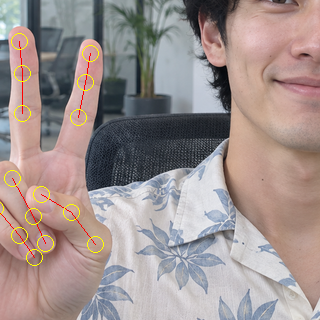

# 指の指標（#2 の決定）

メイン指標は「指が残るかどうか」。この文書で、指の正解の作り方と数値の定義を決める。2026-11-25 23:00 の定期実行で決めた。

## 決定

- 指の正解は、手のキーポイントから作る「指の芯」とする。指の芯は、1本の指の PIP → DIP → TIP の関節（親指は MCP → IP → TIP）を結ぶ折れ線を、太さを持たせて塗った領域。半径は「手首から中指の付け根（MCP）までの距離」の 0.06 倍
- 指の芯は指の内側だけを覆う。だから測れるのは再現率で、IoU ではない。背景へのはみ出しは、EasyPortrait の人物 IoU と Boundary F で別に見る
- キーポイントは2通りで用意する
  - 大量の画像では、MediaPipe の HandLandmarker（`hand_landmarker.task`）で自動で作る
  - 自動検出が手を見落とす難しい素材では、人が1本の指につき3点（PIP、DIP、TIP）を打つ。画素単位のマスクを描くより、ずっと手間が少ない
- 数値は次の3つ。どれも、しきい値 0.5 で 2 値化したマスクで計算する

| 名前 | 定義 | 役割 |
| --- | --- | --- |
| 指の生存率 | 指の芯の再現率が 0.5 以上の指の数 ÷ 指の数 | メイン指標。「指が消えた」を1本単位で数える |
| 指の芯の再現率 | 指の芯のうちマスクに入った画素の割合。全画素で集計する | 下層指標。消え方の度合い |
| 指の種類別の生存率 | 親指から小指まで、指ごとに分けた生存率 | 下層指標。ピースサインの中指のように、立てた細い指が先に消えるかを見る |

- 合格条件は PLAN.md のとおり。1フレーム 8ms 以下（基準環境の Chrome）、EasyPortrait の人物 IoU が基準を下回らないこと

## 集計

`bench/finger_core.py` は指1本ごとに JSON を1行出す。`bench/finger_summary.py` がそれを読み、モデルごとに指の生存率（と標準誤差。同じ画像の指はまとめて消えやすいので、画像を単位にして計算する）、全画素で集計した指の芯の再現率、指の種類別の生存率を出す。

## 試した結果

`bench/finger_core.py` で、公開素材 `office-peace.png`（AI 生成）を測った。

黄色の円と赤い線が指の芯。立てた2本の指でも、曲げた指でも、指の内側に収まっている（目で確認）。

| 指 | multiclass | selfie_segmenter（square） | landscape |
| --- | --- | --- | --- |
| 親指 | 1.00 | 1.00 | 1.00 |
| 人差し指 | 1.00 | 1.00 | 0.75 |
| 中指 | 1.00 | 0.32 | 0.00 |
| 薬指 | 1.00 | 1.00 | 1.00 |
| 小指 | 1.00 | 1.00 | 1.00 |

- square と landscape は、立てた2本のうち画像の左の指を消す（指の芯の再現率 0.32 と 0.00）。`bench/cutout.py` の背景差し替えの画像で、同じ指が薄くなっているのを目で確かめた。指の名前（表の「中指」）は HandLandmarker の判定による
- 生存率は multiclass 5/5、square 4/5、landscape 4/5。全画素で集計した指の芯の再現率は 1.00、0.85、0.74（`finger_summary.py`）。1枚だけなので、モデルの順位の根拠にはしない
- 半径を 0.10 にすると、指の芯が指の外にはみ出し、multiclass の再現率が 0.92〜0.94 に下がった。はみ出した背景の画素が「消えた指」として数えられるため。0.06 では、はみ出しが目で見て無い
- 付け根の区間（MCP → PIP）まで含めると、landscape の中指の再現率が 0.00 から 0.22 に上がった。付け根は残りやすく、指先の欠けが薄まる。だから指の芯は PIP（親指は MCP）から先に限る

## 制約

- **自動検出は難しい場面を見落とす。** 非公開の実写1件（multiclass でも指が消える素材）では、手が画面の左端で切れていて、HandLandmarker は手を検出しなかった。検出のしきい値を 0.05 まで下げると「手」を1つ返したが、実際の指の上には無く、誤検出だった。自動検出だけで素材を集めると、指が消えやすい場面ほど評価から外れる。難しい素材は人がキーポイントを打つ
- 自動検出で作った正解は、HandLandmarker の誤りをそのまま含む。素材に入れる前に、重ね合わせ画像を目で確かめる
- 指の芯がすべて画面の外にある指は数えない。手を1つも検出しなかった画像は、標準エラーにその旨を出す
- 指の芯は指の太さを測らない。指の輪郭が細る失敗は、指の芯の再現率には出にくい。輪郭は Boundary F で見る

## 採らなかった方法

| 方法 | 採らなかった理由 |
| --- | --- |
| 重いオフラインのモデル（SAM など）で下書きして、人が直す | 画素単位の修正は人の手間が大きく、定期実行のエージェントには直せない。下書きのモデル自身が指を消すと、正解が基準モデルと同じ誤りを持つ |
| Open Images の手の bbox で人物マスクを切る（今の「手の領域の IoU」） | bbox の中には指の間の背景も入る。指が消えたのか、指の間の背景を正しく抜いたのかを区別できない |

## 次にやること

- HaGRID v1 から、手が写った画像を集めて評価セットにする（#1 のコメントの方針）。ライセンスを配布元で確かめてから使う
- 難しい素材にキーポイントを打つための JSON の形式は、`bench/finger_core.py` の docstring にある（#18）。手1つにつき、手首、中指の付け根、指ごとの3点を、元画像の画素座標で書く。手首と中指の付け根は指の芯の半径を決めるのに要る。画面の外の座標も書いてよい（手が端で切れた素材のため）。ファイルにある画像は自動検出を使わず、書いた手と指だけを評価する。出力の行の `source` が `manual` になる
- 下書きは `bench/keypoints_draft.py` で作る。HandLandmarker の結果を同じ形式で書き出すので、人はずれた点を直し、見落とした手を足せばよい。手が見つからなかった画像は空のリストになる
- 下書きをそのまま読み込むと、HaGRID v1 の300枚（1,422本）で、自動検出と同じ行がすべて出る。CI でも公開素材でこの往復を確かめる
- 注意: 指の芯は PIL の太い線で塗るので、点が 0.01px ずれただけで芯の画素数が10px ほど変わることがある。座標を小数2桁に丸めた試しでは、1,422本のうち71本で画素数が変わり、指が残ったかどうかの判定は1本（landscape）で変わった。人が打つ点は1px 単位なので、同じくらいの揺れが出る（推論）
- HandLandmarker のモデルのライセンスを、モデルカードで一次確認する（まだ確かめていない）
